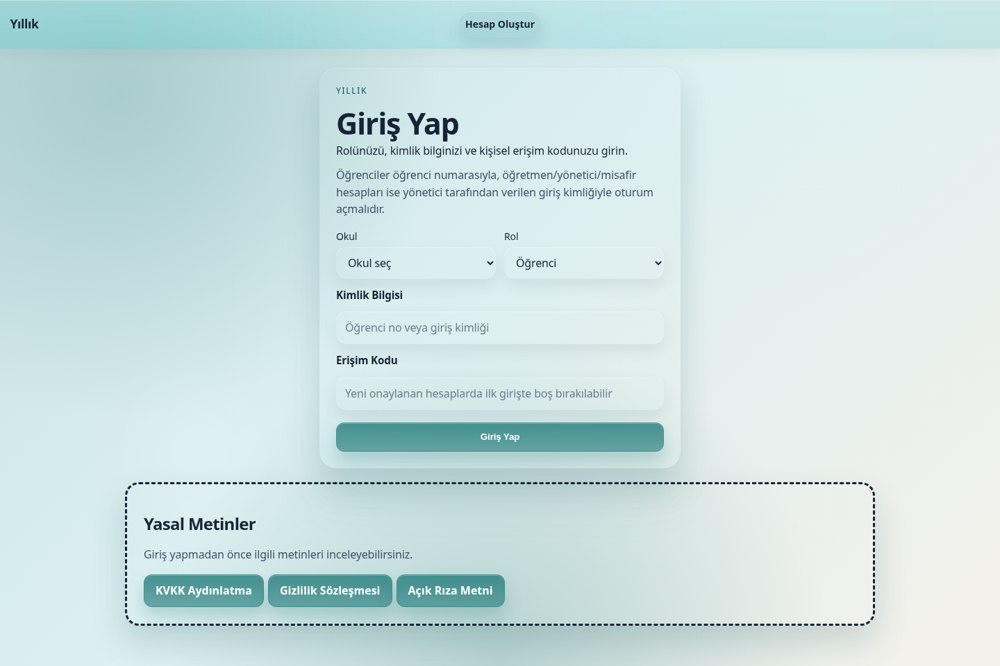
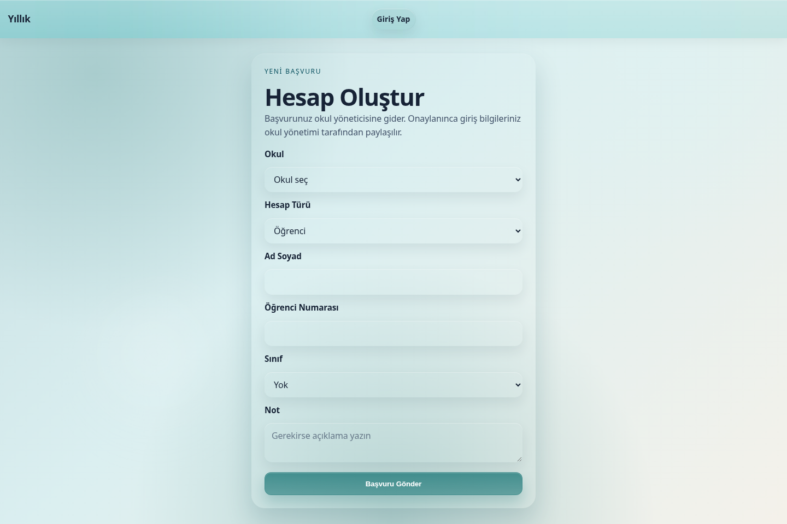
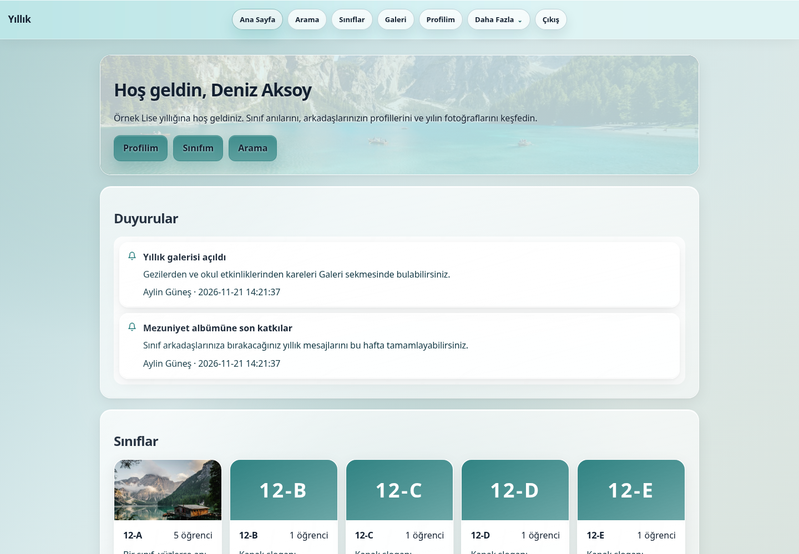
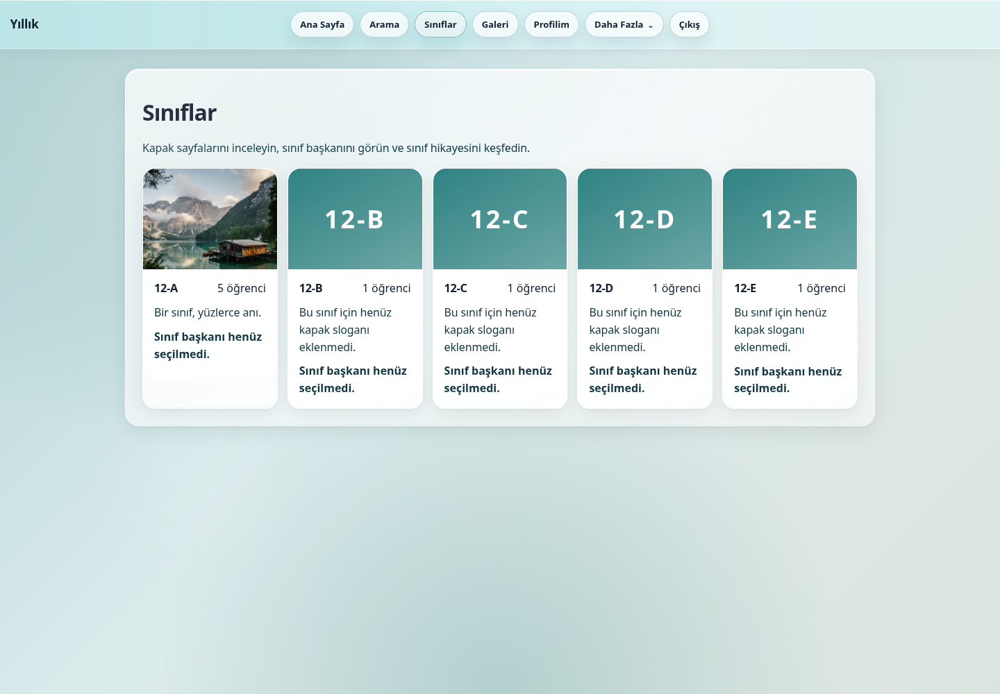
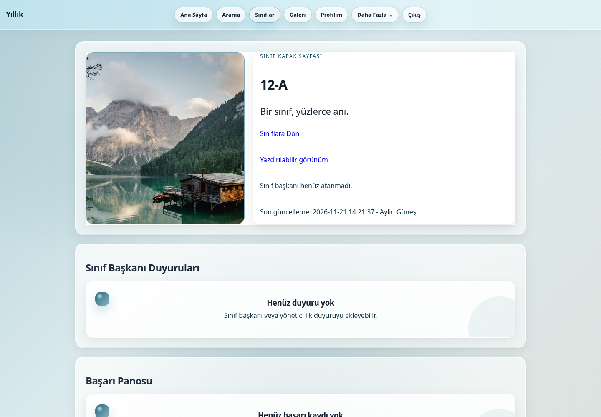
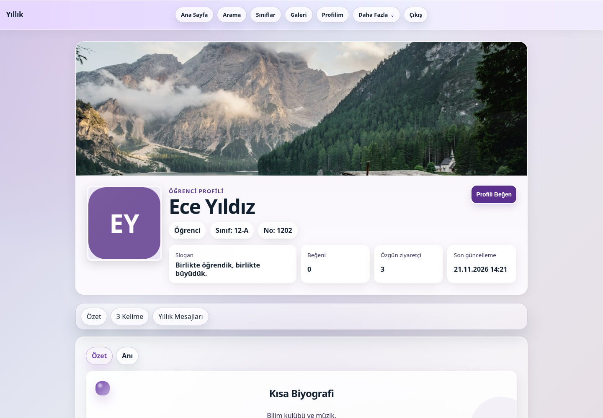
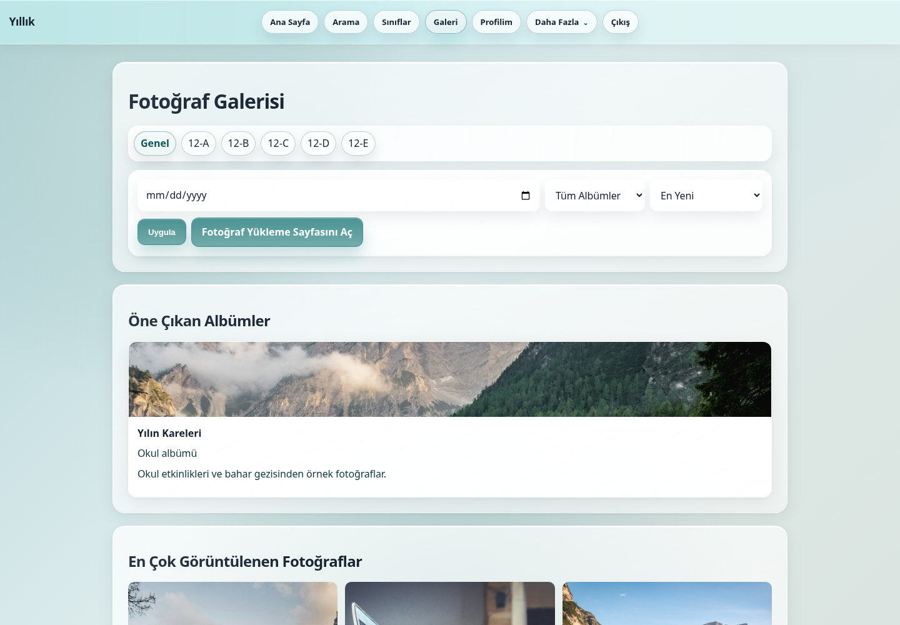
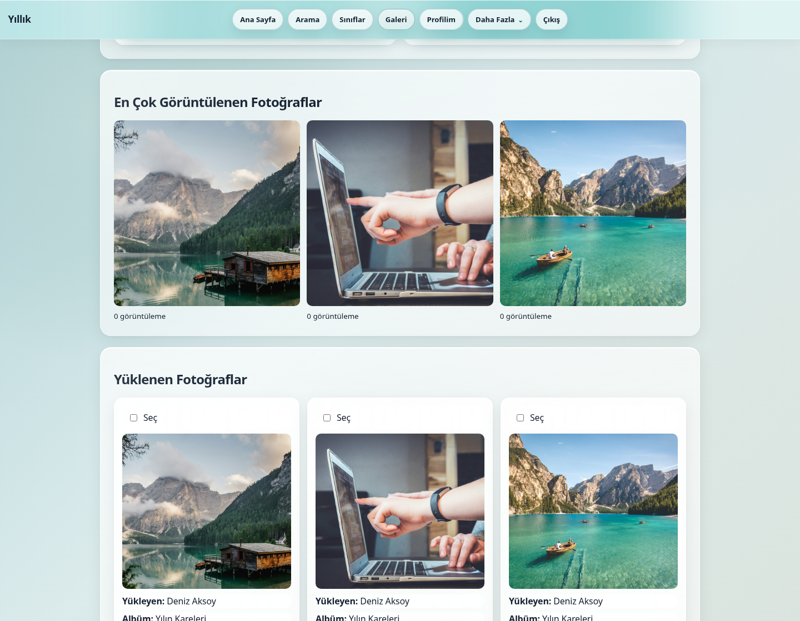

# Digital Yearbook

Digital Yearbook is a server-rendered web application for creating private school yearbooks. It supports role-based access, student and teacher profiles, moderated messages, class pages, photo galleries, consent flows, and offline export.

## Highlights

- Access-code authentication with hashed access codes and role-based authorization
- Student, teacher, administrator, and guest accounts
- Class pages, profiles, messages, announcements, galleries, and printable views
- Consent, privacy, moderation, audit-log, and access-control features
- Excel import, backups, and offline yearbook export tools
- Optional embedded board-game routes

## Stack

- Node.js and Express
- EJS templates and browser-side JavaScript
- SQLite for local development; PostgreSQL supported through `DATABASE_URL`

## Quick start

Requirements: Node.js 20 or newer.

```bash
cd backend
npm ci
cp ../.env.example ../.env
npm run init-db
npm run dev
```

Open `http://127.0.0.1:3000`.

## Configuration

Copy `.env.example` to `.env` and set a strong `SESSION_SECRET` before any production deployment. If `DATABASE_URL` is set, the application uses PostgreSQL; otherwise it creates a local SQLite database under `database/`.

## Data safety

This repository intentionally contains no real accounts, access codes, database files, backups, uploads, logs, or deployment credentials. Use only synthetic data in development and keep production data outside version control.

## Testing

```bash
cd backend
npm test
```

## License

No license is granted. All rights reserved.


## Images


<!-- project-screenshot-gallery:start -->
## Demo screenshots

The signed-in screens show Liquid Glass v3 in a local demo with fictional student accounts and stock photographs. [Photo 1](https://images.unsplash.com/photo-1470770841072-f978cf4d019e) · [Photo 2](https://images.unsplash.com/photo-1516321318423-f06f85e504b3) · [Photo 3](https://images.unsplash.com/photo-1501785888041-af3ef285b470)

<p>
  <a href="docs/screenshots/readme/01-yilliga-giris.png"></a>
  <a href="docs/screenshots/readme/02-hesap-basvurusu.png"></a>
</p>

<p>
  <a href="docs/screenshots/readme/03-yillik-ana-sayfa.png"></a>
  <a href="docs/screenshots/readme/04-siniflar.png"></a>
</p>

<p>
  <a href="docs/screenshots/readme/05-sinif-sayfasi.png"></a>
  <a href="docs/screenshots/readme/06-ogrenci-profili.png"></a>
</p>

<p>
  <a href="docs/screenshots/readme/07-fotograf-galerisi.png"></a>
  <a href="docs/screenshots/readme/08-galeri-albumu.png"></a>
</p>
<!-- project-screenshot-gallery:end -->
